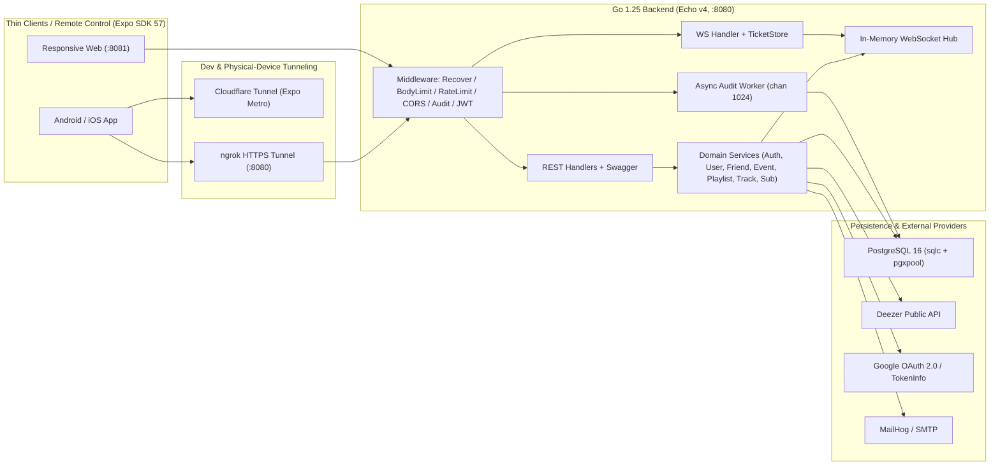
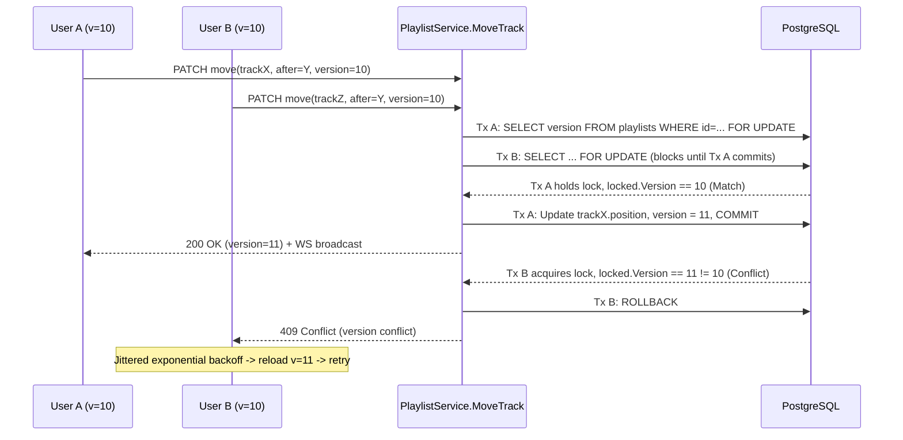
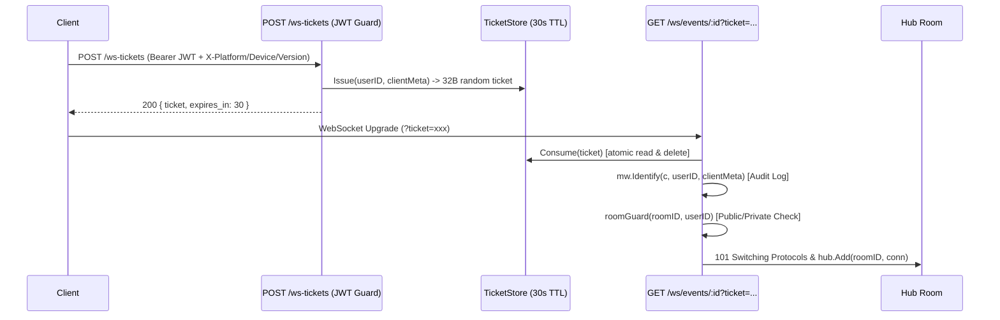
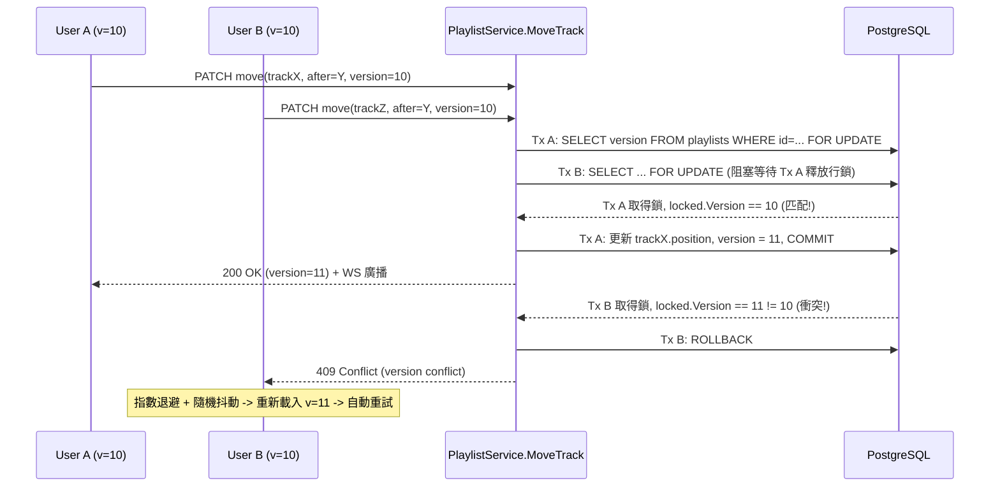
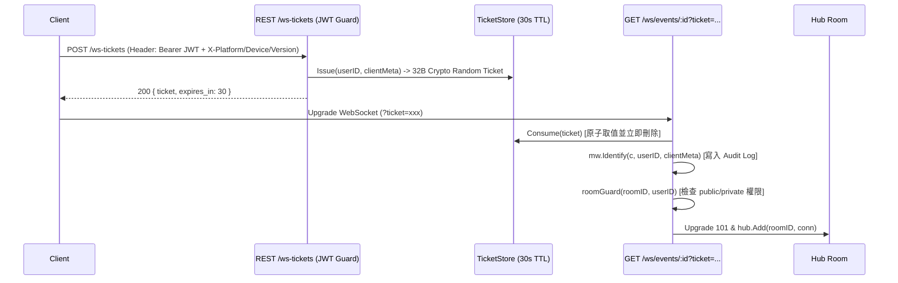

<p align="right">
  <a href="#musicroom-zh-walkthrough">
    
  </a>
</p>

# MusicRoom — Technical Walkthrough & Architecture Deep-Dive <a id="musicroom-en-walkthrough"></a>

> Authored per [`docs/SOP.md`](./SOP.md) as the project's **Technical Bible, Mathematical Derivation Manual, and Peer Evaluation Defense Arsenal**.
> For specification tracking and backlog status, see [`docs/TODO.md`](./TODO.md).

## Table of Contents
- [1. System Architecture & Technology Rationale](#1-system-architecture--technology-rationale)
- [2. Database Schema Design & Invariants](#2-database-schema-design--invariants)
- [3. Core Algorithms & Concurrency Mathematics](#3-core-algorithms--concurrency-mathematics)
  - [3.1 Music Track Vote — Idempotent Voting & Deterministic Ordering](#31-music-track-vote--idempotent-voting--deterministic-ordering)
  - [3.2 Geo-Fencing Mathematics — Haversine Great-Circle Distance](#32-geo-fencing-mathematics--haversine-great-circle-distance)
  - [3.3 Music Playlist Editor — OCC + Fractional Indexing + Auto-Renormalization](#33-music-playlist-editor--occ--fractional-indexing--auto-renormalization)
- [4. Real-Time Messaging Architecture (WebSocket Hub & Ticket Auth)](#4-real-time-messaging-architecture-websocket-hub--ticket-auth)
- [5. Security Defense-in-Depth & Threat Model](#5-security-defense-in-depth--threat-model)
- [6. Load Benchmarks & Capacity Planning (Ramp-up)](#6-load-benchmarks--capacity-planning-ramp-up)
- [7. Bonus Architecture Deep-Dive](#7-bonus-architecture-deep-dive)
- [8. Red-Team Oral Defense Drill (Phase 6 High-Frequency Examiner Questions)](#8-red-team-oral-defense-drill-phase-6-high-frequency-examiner-questions)

---

## 1. System Architecture & Technology Rationale

### 1.1 System Topology



### 1.2 Technology Choices & Trade-offs (Subject Ch. IV.1 / V.3 / V.4)

| Architectural Choice | Selected Stack | Engineering Rationale & Trade-offs |
| :--- | :--- | :--- |
| **Backend Runtime** | **Go 1.25 + Echo v4** | 1. **Lightweight Concurrency**: Goroutines start at ~2 KB stack, easily handling thousands of concurrent WebSocket connections (1,500 concurrent clients benchmarked with 0% error).<br>2. **Minimal Container Footprint**: Multi-stage [`Dockerfile`](../musicroom-backend/Dockerfile) compiles a static binary on `alpine:3.20`.<br>3. **Low Magic**: Explicit routing, middleware chaining, and error mapping with zero framework black-boxes. |
| **Data Access Layer** | **PostgreSQL 16 + `sqlc` + `pgx/v5`** | **Deliberate Rejection of ORMs**: `sqlc` compiles hand-written SQL in [`queries/*.sql`](../musicroom-backend/queries) into type-safe Go code at build time. Every query plan is transparent, N+1 queries are eliminated, and PG-native primitives (`citext`, `jsonb`, `pg_trgm`, partial indexes, `SELECT FOR UPDATE`, `ON CONFLICT`) are used directly. |
| **API Style & Format** | **REST + JSON + Swagger (OpenAPI)** | REST delivers statelessness, clear HTTP semantics (`401`/`402`/`403`/`409`/`429`), and auto-generated Swagger docs (`/swagger/index.html`) for third-party integrations. JSON provides universal readability and native serialization across Go and TypeScript. |
| **Real-Time Strategy** | **REST Mutations + One-Way WS Broadcast** | All state mutations flow through authenticated, rate-limited, audited REST endpoints; committed transactions trigger a server-to-client WebSocket push. This enforces DRY by avoiding duplicated auth, validation, and retry semantics over WebSockets. |
| **Mobile / Web Client** | **React Native + Expo SDK 57 + TS** | Single codebase serving Android, iOS, and Responsive Web (unlocking Bonus VI.1), keeping the client strictly a "remote control" to the backend. |
| **Music Catalog** | **Deezer API (Backend-Proxied & Cached)** | Unauthenticated track search + 30-second audio previews. Because Deezer preview URLs carry expiring signatures, the backend exposes `GET /tracks/:id/preview` to refresh them on demand ([`track.go`](../musicroom-backend/internal/service/track.go#L47-L54)). |

---

## 2. Database Schema Design & Invariants

Full schema: [`musicroom-backend/schema.sql`](../musicroom-backend/schema.sql), applied sequentially via [`migrations/000001..000010`](../musicroom-backend/migrations) by the one-shot `migrate` service before the API boots.

### 2.1 Database-Enforced Invariants
Design philosophy: **Push integrity guarantees down to PostgreSQL constraints so concurrent writers can never corrupt state even under race conditions.**

1. **Canonical Undirected Friendships** ([`schema.sql#L105-L111`](../musicroom-backend/schema.sql#L105-L111)):
   - `PRIMARY KEY (user_id_a, user_id_b)` combined with `CHECK (user_id_a < user_id_b)`.
   - Paired with `canonical(x, y)` in [`friend.go#L143-L148`](../musicroom-backend/internal/service/friend.go#L143-L148), `(Alice, Bob)` and `(Bob, Alice)` always map to a single row, preventing duplicate edges.
2. **Partial Unique Index on Pending Requests** ([`schema.sql#L101-L102`](../musicroom-backend/schema.sql#L101-L102)):
   - `uq_friend_requests_pending ON friend_requests(requester_id, addressee_id) WHERE status = 'pending'` allows re-requesting after rejection while forbidding duplicate active requests.
3. **Time & Location License Integrity** ([`schema.sql#L140-L147`](../musicroom-backend/schema.sql#L140-L147)):
   - `chk_event_time_location` guarantees that `time_and_location` events cannot exist without non-null start/end timestamps (`vote_end_at > vote_start_at`), coordinates, and `vote_radius_meters > 0`.
4. **Case-Insensitive Unique Emails**: `citext` ([`schema.sql#L21`](../musicroom-backend/schema.sql#L21)) prevents duplicate accounts differing only in letter case.
5. **Fast Substring Search & Hot-Path Partial Indexes**: GIN + `pg_trgm` on `users.display_name`; partial indexes on `events` (`visibility = 'public'`), `playlists` (`visibility = 'public'`), and `event_tracks` (`played_at IS NULL`).

---

## 3. Core Algorithms & Concurrency Mathematics

### 3.1 Music Track Vote — Idempotent Voting & Deterministic Ordering

- **Source**: [`internal/service/event.go#L143-L188`](../musicroom-backend/internal/service/event.go#L143-L188), [`internal/repository/votes.sql.go#L15-L51`](../musicroom-backend/internal/repository/votes.sql.go#L15-L51)
- **Concurrency Problem**: Double-taps or hundreds of users voting simultaneously for the same or different tracks.
- **Mechanism**:
  1. Composite key `PRIMARY KEY (event_track_id, user_id)` guarantees at-most-one vote per `(user, track)`.
  2. Atomic idempotent write:
     ```sql
     INSERT INTO votes (event_track_id, user_id)
     VALUES ($1, $2)
     ON CONFLICT (event_track_id, user_id) DO NOTHING;
     ```
  3. Broadcast throttling: `s.broadcastQueue(ctx, eventID)` fires **only when `RowsAffected() > 0`**, avoiding redundant WebSocket fan-out on duplicate clicks.
  4. **Deterministic Tie-Breaking**: `ORDER BY vote_count DESC, et.created_at ASC` ensures identical queue ordering across all clients when tracks tie in votes.

---

### 3.2 Geo-Fencing Mathematics — Haversine Great-Circle Distance

- **Source**: [`internal/service/event.go#L374-L382`](../musicroom-backend/internal/service/event.go#L374-L382)
- **Rule**: Under `time_and_location` license, a vote succeeds iff:
  1. $t_{\text{start}} \le t_{\text{server\_now}} \le t_{\text{end}}$ (enforced via server clock to prevent client clock tampering).
  2. $d((\phi_1, \lambda_1), (\phi_2, \lambda_2)) \le R_{\text{event}}$ (in meters).

- **Formula**:
  Convert degrees to radians ($\text{rad} = \frac{\pi}{180}$), let mean Earth radius $R = 6{,}371{,}000\text{ m}$, $\Delta\phi = \phi_2 - \phi_1$, $\Delta\lambda = \lambda_2 - \lambda_1$:
  $$a = \sin^2\left(\frac{\Delta\phi}{2}\right) + \cos(\phi_1)\cos(\phi_2)\sin^2\left(\frac{\Delta\lambda}{2}\right)$$
  $$d = 2 R \cdot \operatorname{atan2}\left(\sqrt{a},\ \sqrt{1 - a}\right)$$

- **Numerical Stability & Precision Notes**:
  - **Why Haversine over Spherical Law of Cosines?** For short party-venue distances (e.g., 50 m), $\cos(\Delta) \approx 1$ suffers catastrophic floating-point cancellation; Haversine operates on $\sin(\Delta/2)$ and remains accurate at meter scale.
  - **Why `atan2(sqrt(a), sqrt(1-a))` over `asin(sqrt(a))`?** Near antipodal points, floating-point rounding can push $a$ slightly above $1$, causing `asin` to yield `NaN`; `atan2` handles this cleanly.
  - **Error Bound**: Spherical approximation vs. WGS-84 ellipsoid deviates by at most ~0.3%–0.5% (< 0.5 m on a 100 m radius), an order of magnitude smaller than consumer smartphone GPS noise (3–15 m).

---

### 3.3 Music Playlist Editor — OCC + Fractional Indexing + Auto-Renormalization

- **Source**:
  - Backend transaction & locking: [`internal/service/playlist.go#L241-L304`](../musicroom-backend/internal/service/playlist.go#L241-L304)
  - Position computation & renormalization: [`internal/service/playlist.go#L491-L548`](../musicroom-backend/internal/service/playlist.go#L491-L548)
  - Client retry backoff: [`PlaylistDetailScreen.tsx#L19-L25`](../musicroom-app/src/screens/playlists/PlaylistDetailScreen.tsx#L19-L25) & [`#L78-L100`](../musicroom-app/src/screens/playlists/PlaylistDetailScreen.tsx#L78-L100)

#### Step 1: Semantic Relative Moves (`after_track_id`)
Clients specify *"move `trackID` immediately after `after_track_id` (or `null` for top)"* along with their last observed playlist `version`, preserving user intent even if unrelated tracks are added or removed elsewhere.

#### Step 2: Row Lock Serialization + Optimistic Concurrency Control (OCC)


#### Step 3: Fractional Indexing & IEEE-754 Precision Exhaustion Defense
Integer indices ($1, 2, \dots, N$) require $O(N)$ row updates per reorder. Using `double precision` (`float64`):
- Move to top (`afterIdx < 0`): $p_{\text{new}} = p_0 - 1.0$ (or $1.0$ if empty).
- Move to bottom (`afterIdx == len - 1`): $p_{\text{new}} = p_{\text{last}} + 1.0$.
- Insert between neighbors $(p_L, p_U)$:
  $$p_{\text{new}} = \frac{p_L + p_U}{2}$$
  This achieves **$O(1)$ single-row update** in the common case.

- **Guard Against Precision Collapse**:
  Repeatedly inserting into the same gap halves the spacing ($2^{-k}$). IEEE-754 `float64` provides 53 significand bits (~52 bisections before underflow makes $p_{\text{new}} = p_L$). In [`playlist.go#L19`](../musicroom-backend/internal/service/playlist.go#L19) & [`#L547`](../musicroom-backend/internal/service/playlist.go#L547), we enforce a wide safety threshold:
  $$\text{positionMinGap} = 10^{-6},\quad \text{Renormalize if } (p_U - p_L) < 2 \times 10^{-6}$$
  After ~19 consecutive insertions into the exact same slot, while **already holding the playlist's `FOR UPDATE` lock**, `placeTrack` atomically reassigns all other tracks to $1.0, 2.0, \dots, m.0$ and places the moved track at `idx + 1.5` (or `0.5` / `m + 1`), completely restoring full spacing with zero race windows.

#### Step 4: Client Jittered Exponential Backoff
When concurrent editors collide and receive `409 Conflict`, immediate retries would collide again in lockstep. Both the mobile app and `k6` Scenario 3 retry up to `MOVE_MAX_RETRIES = 5` times with base `20 ms`:
$$\Delta t_k = \text{span}_k + U(0, 1) \cdot 1.5 \cdot \text{span}_k,\quad \text{where } \text{span}_k = 20 \cdot 2^k \text{ ms}$$
Wait ranges: `[20, 50]ms` → `[40, 100]ms` → `[80, 200]ms` → `[160, 400]ms` → `[320, 800]ms`, reloading the latest `version` before each retry. Under 20 concurrent editors, **1,810 moves completed with 0 unresolved conflicts**.

---

## 4. Real-Time Messaging Architecture (WebSocket Hub & Ticket Auth)

- **Source**: [`internal/api/handlers/ws.go`](../musicroom-backend/internal/api/handlers/ws.go), [`internal/auth/ticket.go`](../musicroom-backend/internal/auth/ticket.go), [`internal/hub/hub.go`](../musicroom-backend/internal/hub/hub.go), [`musicroom-app/src/ws/useWebSocket.ts`](../musicroom-app/src/ws/useWebSocket.ts)

### 4.1 Why One-Time Tickets Instead of JWT in Query Strings?
Browser `WebSocket` APIs cannot set custom `Authorization` headers. Putting a 15-minute JWT in `?token=...` leaks credentials into proxy logs and browser history. Instead:



### 4.2 Concurrency Safety & Slow Consumer Isolation
- **Locking**: `Hub` protects `rooms map[uuid.UUID]map[*Client]struct{}` with `sync.RWMutex`; broadcasts hold only `RLock`.
- **Per-Connection Pumps**: Dedicated `writePump` (sole writer, 54s Ping heartbeat) and `readPump` (60s Pong deadline, 512-byte read limit).
- **Non-Blocking Fan-Out** ([`hub.go#L63-L72`](../musicroom-backend/internal/hub/hub.go#L63-L72)): Buffered `send` channel (cap 16) with non-blocking `select { case c.send <- msg: default: }` ensures one stalled mobile connection never blocks broadcasts to healthy peers.
- **Revocation Disconnect**: `CloseRoom(playlistID)` forcibly drops all room sockets when a playlist becomes private or a collaborator is removed, forcing re-authentication through `CanAccessPlaylistRoom`.

---

## 5. Security Defense-in-Depth & Threat Model

### 5.1 Implemented Protections ([`internal/service/auth.go`](../musicroom-backend/internal/service/auth.go))

| Layer | Mechanism | Threat Mitigated |
| :--- | :--- | :--- |
| **Password Hashing** | `bcrypt` Cost 12 ([`password.go`](../musicroom-backend/internal/auth/password.go)) | ~200 ms CPU cost per hash severely slows offline cracking. |
| **Immediate JWT Revocation** | HS256 JWT (15m) carrying `jti` + `epoch`, verified via [`CheckAccessToken`](../musicroom-backend/internal/service/auth.go#L305-L320) | Single-device logout blacklists only `jti` (`revoked_access_tokens`); password reset bumps `users.token_epoch` to invalidate **all** active sessions globally. |
| **Refresh Token Rotation & Reuse Detection** | 32-byte random token stored as SHA-256 hash with `family_id` & `replaced_by` ([`auth.go#L198-L252`](../musicroom-backend/internal/service/auth.go#L198-L252)) | Presenting an already-revoked refresh token immediately revokes the **entire `family_id`**, neutralizing stolen-token replay. |
| **Account Lockout** | 5 failed logins within 15 min locks account for 15 min ([`auth.go#L34-L38`](../musicroom-backend/internal/service/auth.go#L34-L38)) | Defends target accounts even against distributed proxy brute-force. |
| **Dual-Layer Rate Limiting** | Global 20 req/s/IP + `/auth/*` 10 req/min/IP (burst 3) ([`router.go#L42-L59`](../musicroom-backend/internal/api/router.go#L42-L59)) | Mitigates credential stuffing, API scraping, and email spam. |
| **Google OAuth PKCE S256 + Anti-Open-Redirect** | Client generates 32-byte `verifier` & S256 `challenge`; backend exchanges via single-use handoff code verified with `subtle.ConstantTimeCompare` ([`googleflow.go#L186-L193`](../musicroom-backend/internal/api/handlers/googleflow.go#L186-L193)) | Blocks malicious apps hijacking custom URL schemes, prevents Open Redirects via `resolveReturn` whitelist, and avoids timing side-channels. |
| **Anti-Enumeration** | `ForgotPassword` always returns `202 Accepted` regardless of account existence | Prevents email discovery. |
| **Secure Client Storage** | `expo-secure-store` (iOS Keychain / Android Keystore) on mobile; `AsyncStorage` fallback on web | Protects stored tokens with OS-level encryption on mobile. |

### 5.2 Asynchronous Audit Pipeline
[`internal/api/middleware/audit.go`](../musicroom-backend/internal/api/middleware/audit.go) captures `UserID`, `Action`, parsed singular `ResourceType`/`ResourceID`, `X-Platform`, `X-Device-Model`, `X-App-Version`, `IP`, `UserAgent`, and `StatusCode` on every non-`/health` request and dispatches them into a 1024-capacity channel processed by [`audit.Recorder`](../musicroom-backend/internal/audit/recorder.go). On `SIGINT`/`SIGTERM`, [`main.go#L67-L70`](../musicroom-backend/cmd/server/main.go#L67-L70) shuts down HTTP first and then calls `auditClose()` to flush remaining entries cleanly.

### 5.3 Residual Hazards & Production Mitigations (Subject Ch. V.6)
1. **GPS Spoofing**: Client-reported coordinates can be mocked on rooted devices → *Mitigation*: combine with venue-rotating QR codes, Bluetooth iBeacons (Bonus VI.2), or impossible-travel velocity checks.
2. **`X-Real-IP` Header Spoofing**: Currently trusted for E2E multi-IP simulation → *Mitigation*: behind Nginx/Cloudflare, configure `e.IPExtractor` to trust only known reverse-proxy CIDRs.
3. **Single-Node In-Memory State**: `RateLimiter`, `TicketStore`, OAuth state stores, and `Hub` live in process RAM → *Mitigation*: move rate limits and tickets to **Redis (TTL + Lua)** and federate WebSockets via **Redis Pub/Sub or NATS**.
4. **TLS Termination & Web Token Storage**: Deploy TLS 1.3 + HSTS at the ingress proxy; migrate Web refresh tokens to `HttpOnly; Secure; SameSite=Strict` cookies to neutralize XSS.
5. **Per-Request DB Lookup for JWT Verification**: High-throughput deployments can cache `token_epoch` and revoked `jti` entries in Redis to offload PostgreSQL.

---

## 6. Load Benchmarks & Capacity Planning (Ramp-up)

Full report: [`musicroom-backend/docs/BENCHMARK.md`](../musicroom-backend/docs/BENCHMARK.md).

- **Test Host**: Lenovo Yoga Slim 7 Pro — AMD Ryzen 7 5800H (8C/16T), 13 GiB RAM, Arch Linux, Docker Compose (App + Postgres 16 co-located).
- **Methodology**: Rate limiters are temporarily lifted via `RATE_LIMIT_DISABLED=true` (emitting a startup warning; typos/zeros safely fall back to defaults) so `k6` measures the backend rather than the limiter.

| Scenario | Script | Load Profile | Measured Performance | Error Rate | Bottleneck Analysis |
| :--- | :--- | :--- | :--- | :---: | :--- |
| **1. Auth Throughput** | `benchmarks/auth.js` | 50 → 200 VUs (`/auth/login`) | Peak **56.3 logins/s**; usable sweet spot **35.9 logins/s** (p95 = 513 ms) | **0%** | **CPU-bound (by design)**: `bcrypt` cost 12 intentionally burns ~200 ms CPU per login. |
| **2. Concurrent Votes (WS)** | `benchmarks/vote-ws.js` | 100 / 500 / **1,500 VUs** | At 1,500 VUs: WS connect p95 = **98.9 ms**, HTTP p95 = **61.3 ms** | **0%** | **Headroom remaining**: ~10 KB RAM per WS client (1,000 conns ≈ 10 MB); zero duplicate votes. |
| **3. Concurrent Playlist Edits** | `benchmarks/playlist-ws.js` | 20 VUs moving same track (3 × 30s) | 1,810 total moves, 75 conflicts (`409`), HTTP p95 ≈ **7.9 ms** | **0 unresolved** | Row lock + 5-attempt jittered backoff resolved 100% of collisions; version advanced 563 → 2,373 with zero lost writes. |

---

## 7. Bonus Architecture Deep-Dive

### 7.1 Multi-Platform Support (Responsive Web) — Subject VI.1
- **Platform-Specific Module Resolution**: Metro automatically picks `.web.ts` overrides ([`tokenStore.web.ts`](../musicroom-app/src/storage/tokenStore.web.ts), [`defaultBaseUrl.web.ts`](../musicroom-app/src/storage/defaultBaseUrl.web.ts)) for Web builds.
- **Responsive Layout**: [`useResponsive.ts`](../musicroom-app/src/theme/useResponsive.ts) defines `WIDE_BREAKPOINT = 900` and `CONTENT_MAX_WIDTH = 820`, centering desktop layouts and swapping native drag gestures for accessible up/down buttons on Web (`CAN_DRAG = Platform.OS !== 'web'`).
- **Unified Origin Policy**: `CORS_ORIGINS` feeds both Echo CORS middleware and Gorilla WebSocket `CheckOrigin`.

### 7.2 Free vs. Paid Subscription — Subject VI.3
- **Source**: [`internal/service/subscription.go`](../musicroom-backend/internal/service/subscription.go), [`internal/service/playlist.go#L59-L66`](../musicroom-backend/internal/service/playlist.go#L59-L66) & [`#L461`](../musicroom-backend/internal/service/playlist.go#L461).
- **Zero-Cron Expiration**: Premium grants `now() + 30 days` and records an audit row in `subscription_history`. Effective tier is computed on read (`GetEffectiveTier` + `subscriptionFrom`), so expired accounts downgrade instantaneously without background job lag (verified by [`TestPremiumExpiresWithoutAJob`](../musicroom-backend/internal/api/integration_test.go#L835)).
- **Feature Gate**: Free users can manage their own playlists, while inviting editable collaborators or editing another user's playlist requires `premium` (returning **`402 Payment Required`** otherwise).

---

## 8. Red-Team Oral Defense Drill (Phase 6 High-Frequency Examiner Questions)

1. **Q: Why use BOTH `SELECT ... FOR UPDATE` (pessimistic lock) AND `version` (optimistic lock) for playlists? Isn't that redundant?**
   - **A**: They solve orthogonal race windows. **Optimistic locking (`version`)** spans human think-time across separate HTTP requests so a user dragging on a stale screen cannot silently overwrite another editor's recent reorder. **Pessimistic locking (`FOR UPDATE`)** serializes microsecond-level DB transactions so *"read version → compute fractional position (and renormalize if needed) → bump version"* executes atomically with zero TOCTOU race.

2. **Q: What happens when Fractional Indexing runs out of `float64` precision? Can two tracks collide at the same position?**
   - **A**: Never. IEEE-754 `float64` holds 53 significand bits (~52 halvings before collapse), but we trigger renormalization aggressively whenever `(upper - lower) < 2e-6` (~19 consecutive bisections in the exact same gap). Because the transaction already holds the playlist's `FOR UPDATE` row lock, all other tracks are safely renumbered to `1.0, 2.0, ..., m.0` and the target is placed at `idx + 1.5`, fully restoring spacing.

3. **Q: If 20 users reorder the same playlist simultaneously, can moves be lost or loop forever?**
   - **A**: No. Atomicity guarantees exactly one writer commits per version while others get `409 Conflict`. Losers reload the latest version and retry up to 5 times with jittered exponential backoff (`20 * 2^k` + random jitter), breaking lockstep collisions. Benchmark Scenario 3 verified 1,810 concurrent moves with 0 lost updates and 0 retries exhausted.

4. **Q: Why keep mutations on REST and only broadcast over WebSocket instead of doing everything over WebSocket?**
   - **A**: Keeping writes on REST lets us reuse input validation, JWT middleware, dual-layer rate limiting, semantic HTTP status codes (`402`/`403`/`409`/`429`), Swagger documentation, and the audit middleware without duplicating them inside a custom WebSocket protocol (strict DRY).

5. **Q: Why not pass the JWT in the WebSocket query string, and how do tickets prevent replay?**
   - **A**: URLs are logged by reverse proxies and stored in browser history, risking leakage of a 15-minute JWT. `POST /ws-tickets` issues a 32-byte cryptographically random ticket valid for only 30 seconds; `TicketStore.Consume` reads and deletes it atomically under a mutex (strictly single-use) while preserving `Platform`/`Device`/`AppVersion` metadata for audit logs.

6. **Q: How does logging out on Phone A differ from resetting your password with respect to Phone B?**
   - **A**: Logging out on Phone A only inserts Phone A's `jti` into `revoked_access_tokens` and revokes Phone A's refresh token family — **Phone B stays logged in**. Resetting the password atomically increments `users.token_epoch` and revokes all user refresh tokens, immediately rejecting Phone B's JWT on its next request because `claims.Epoch != row.TokenEpoch`.

7. **Q: How do you detect and stop a stolen Refresh Token?**
   - **A**: Via **Refresh Token Rotation + Family Reuse Detection**. Every refresh marks the old token revoked (`replaced_by = newID`). If either the attacker or legitimate user later submits an already-revoked token, the backend sees `rt.RevokedAt.Valid == true` and immediately calls `RevokeTokenFamily(rt.FamilyID)`, invalidating the entire session chain and forcing re-login.

8. **Q: Why does mobile Google Sign-In add a PKCE S256 handoff instead of returning JWTs directly in the deep-link redirect?**
   - **A**: Malicious apps on Android/iOS can register the same custom URI scheme (`musicroom://`) to intercept callback redirects. Returning only a short-lived one-time `code` and requiring `POST /auth/google/exchange` with the client's local PKCE `code_verifier` (checked in constant time against the initial SHA-256 `code_challenge`) renders an intercepted redirect useless to an attacker.

9. **Q: Why didn't you implement Music Control Delegation? Does that fail Mandatory?**
   - **A**: No — it is 100% compliant. [`en.subject.pdf`](./en.subject.pdf) Chapter V.2 (p. 9) explicitly states: *"user must access at least 2 functions out of the following 3 ones"*. Focusing on **Music Track Vote** and **Music Playlist Editor** allowed us to deliver full concurrency safety, all license tiers, live WebSockets, and complete E2E tests (verified by `TestServices_TwoOfThreeAreServed`).

10. **Q: If traffic grows 10×–100× tomorrow, what breaks first and how do you scale it?**
    - **A**: Per [`BENCHMARK.md`](../musicroom-backend/docs/BENCHMARK.md), the first ceiling is **login CPU** (`bcrypt` cost 12 saturates around ~56 logins/s on 8C/16T). Because password hashing is stateless, horizontal scaling of Go API replicas behind a load balancer scales login throughput linearly. Before scaling out, move in-memory `RateLimiter`/`TicketStore` to **Redis**, bridge multi-node WebSocket hubs with **Redis Pub/Sub**, and place **PgBouncer + dedicated PostgreSQL (+ read replicas)** behind the API.

---

<br/>

---

<br/>

<p align="right">
  <a href="#musicroom-en-walkthrough">
    
  </a>
</p>

# MusicRoom — 技術聖經與架構深度解析手冊 (Technical Walkthrough) <a id="musicroom-zh-walkthrough"></a>

> 本文件依據 [`docs/SOP.md`](./SOP.md) 編撰，作為專案的**底層架構聖經、演算法數學推導手冊與 Peer Evaluation 口試答辯武器庫**。
> 規格核對與待辦事項請參閱 [`docs/TODO.md`](./TODO.md#musicroom-zh-todo)。

## 目錄
- [1. 系統全局架構與技術選型論證](#1-系統全局架構與技術選型論證)
- [2. 資料庫 Schema 設計與不變量保護](#2-資料庫-schema-設計與不變量保護)
- [3. 核心演算法與並發數學推導](#3-核心演算法與並發數學推導)
  - [3.1 Music Track Vote：冪等並發投票與確定性排序](#31-music-track-vote冪等並發投票與確定性排序)
  - [3.2 地理圍欄數學推導：Haversine 球面距離公式](#32-地理圍欄數學推導haversine-球面距離公式)
  - [3.3 Music Playlist Editor：樂觀鎖 (OCC) + 分數索引 (Fractional Indexing) + 自動重均勻化](#33-music-playlist-editor樂觀鎖-occ--分數索引-fractional-indexing--自動重均勻化)
- [4. 即時通訊架構 (WebSocket Hub & Ticket Auth)](#4-即時通訊架構-websocket-hub--ticket-auth)
- [5. 安全縱深防禦與威脅模型](#5-安全縱深防禦與威脅模型)
- [6. 負載基準測試與容量分析 (Ramp-up)](#6-負載基準測試與容量分析-ramp-up)
- [7. Bonus 功能架構解析](#7-bonus-功能架構解析)
- [8. 紅隊口試答辯高頻考題 (Phase 6 Defense Drill)](#8-紅隊口試答辯高頻考題-phase-6-defense-drill)

---

## 1. 系統全局架構與技術選型論證

### 1.1 系統拓撲圖


### 1.2 技術選型論證（對應 Subject Ch. IV.1 / V.3 / V.4）

| 技術決策 | 選用方案 | 核心理由與工程權衡 (Trade-offs) |
| :--- | :--- | :--- |
| **後端語言與框架** | **Go 1.25 + Echo v4** | 1. **輕量併發**：Goroutine 初始棧僅 ~2KB，單機可輕鬆撐起數千條 WebSocket 長連線（實測 1,500 併發無壓力）。<br>2. **單一靜態二進制**：[`Dockerfile`](../musicroom-backend/Dockerfile) 採 Multi-stage build，產出極簡 Alpine 映像檔。<br>3. **低抽象成本**：Echo 路由、中間件與錯誤處理直覺透明，無黑箱框架魔法。 |
| **資料存取層** | **PostgreSQL 16 + `sqlc` + `pgx/v5`** | **刻意拒絕 ORM**：使用 `sqlc` 讀取 [`queries/*.sql`](../musicroom-backend/queries) 於編譯期生成強型別 Go 程式碼。SQL 執行計畫 100% 可見可控、杜絕 N+1 查詢，同時善用 PG 原生特性（`citext`, `jsonb`, `pg_trgm`, Partial Indexes, `SELECT FOR UPDATE`, `ON CONFLICT`）。 |
| **API 風格與格式** | **REST + JSON + Swagger (OpenAPI)** | REST 具無狀態、快取友善、HTTP 狀態碼語意清晰（`401`/`402`/`403`/`409`/`429`）之優勢，並以 `swag` 自動生成 `/swagger/index.html` 供第三方開發者串接。JSON 人類可讀、跨 Go/TypeScript 原生支援且與瀏覽器除錯工具零摩擦。 |
| **即時同步策略** | **REST 寫入 + WebSocket 單向廣播** | 所有狀態變更（投票、移動歌曲）走具權限驗證、審計日誌與狀態碼回饋的 REST API；成功提交交易後由伺服器透過 WebSocket 房間推播事件。避免在 WS 層重複實作認證、重試與錯誤語意（嚴守 DRY 原則）。 |
| **行動端框架** | **React Native + Expo SDK 57 + TS** | 一套程式碼同時覆蓋 Android、iOS 與響應式 Web（直通 Bonus VI.1）；透過 Expo Go + Tunnel 讓評審無需編譯原生專案即可實機掃碼驗證。 |
| **音樂來源** | **Deezer API（經後端代理與快取）** | 免費免 OAuth 即可查詢曲庫並取得 30 秒試聽流。由於 Deezer 的 `preview_url` 具時效性簽名，後端提供 `GET /tracks/:id/preview` 即時刷新連結（[`track.go`](../musicroom-backend/internal/service/track.go#L47-L54)）。 |

---

## 2. 資料庫 Schema 設計與不變量保護

完整結構位於 [`musicroom-backend/schema.sql`](../musicroom-backend/schema.sql)，並由 [`migrations/000001..000010`](../musicroom-backend/migrations) 採增量方式演進（`docker-compose.yml` 中的 `migrate` 容器會在 `app` 啟動前完成升級）。

### 2.1 關鍵資料庫級不變量 (DB-Level Invariants)

設計哲學：**不將資料一致性完全寄託於應用層 `if` 判斷，而是下推至資料庫約束（Constraint）做最後一道防線。**

1. **防無向好友重複邊**（[`schema.sql#L105-L111`](../musicroom-backend/schema.sql#L105-L111)）：
   - `friendships` 設有 `PRIMARY KEY (user_id_a, user_id_b)` 與 `CHECK (user_id_a < user_id_b)`。
   - 搭配 [`friend.go#L143-L148`](../musicroom-backend/internal/service/friend.go#L143-L148) 的 `canonical(x, y)` 字典序排序，保證 `(Alice, Bob)` 與 `(Bob, Alice)` 永遠對應唯一一列；另為 `user_id_b` 建立反向索引以加速雙向查詢。
2. **條件式唯一索引（Partial Unique Index）**（[`schema.sql#L101-L102`](../musicroom-backend/schema.sql#L101-L102)）：
   - `uq_friend_requests_pending ON friend_requests(requester_id, addressee_id) WHERE status = 'pending'`：允許曾經被拒絕後再次發出邀請，但嚴格禁止同一方向同時存在多筆待處理邀請。
3. **時間地點授權完整性約束**（[`schema.sql#L140-L147`](../musicroom-backend/schema.sql#L140-L147)）：
   - `chk_event_time_location` 確保當 `license = 'time_and_location'` 時，起訖時間、經緯度與半徑必非 NULL，且 `vote_end_at > vote_start_at`、`vote_radius_meters > 0`。
4. **不分大小寫信箱唯一性**：使用 `citext` 擴充套件（[`schema.sql#L21`](../musicroom-backend/schema.sql#L21)），從根源杜絕 `Alice@a.com` 與 `alice@a.com` 重複註冊漏洞。
5. **模糊搜尋與熱路徑 Partial Index**：`idx_users_display_name_trgm` 使用 GIN + `pg_trgm`；`idx_events_public`、`idx_playlists_public` 僅索引公開項目；`idx_event_tracks_queue` 僅索引未播放曲目（`WHERE played_at IS NULL`）。

---

## 3. 核心演算法與並發數學推導

### 3.1 Music Track Vote：冪等並發投票與確定性排序

- **程式碼位置**：[`internal/service/event.go`](../musicroom-backend/internal/service/event.go#L143-L188)、[`internal/repository/votes.sql.go`](../musicroom-backend/internal/repository/votes.sql.go#L15-L51)
- **競態問題**：同一使用者連點兩次投票，或數百名使用者在同一毫秒對相同/不同曲目投票。
- **解法**：
  1. `votes` 表以 `(event_track_id, user_id)` 作為複合主鍵。
  2. 寫入採用單一原子 SQL：
     ```sql
     INSERT INTO votes (event_track_id, user_id)
     VALUES ($1, $2)
     ON CONFLICT (event_track_id, user_id) DO NOTHING;
     ```
  3. 後端檢查 `RowsAffected()`：僅在 `rows > 0`（實際發生狀態變化）時才呼叫 `s.broadcastQueue(ctx, eventID)`，防止重複請求引發無意義的廣播風暴。
  4. **確定性排序 (Deterministic Tie-Breaking)**：
     ```sql
     ORDER BY vote_count DESC, et.created_at ASC
     ```
     當多首曲目票數相同時，依推薦時間先後穩定排序，確保所有連線用戶看到的佇列順序完全一致，不會在每次查詢間抖動。

---

### 3.2 地理圍欄數學推導：Haversine 球面距離公式

- **程式碼位置**：[`internal/service/event.go#L374-L382`](../musicroom-backend/internal/service/event.go#L374-L382)
- **業務規則**：當活動授權為 `time_and_location` 時，投票必須同時滿足：
  1. $t_{\text{start}} \le t_{\text{now}} \le t_{\text{end}}$（伺服器端時間，防客戶端篡改本機時鐘）。
  2. $d((\phi_1, \lambda_1), (\phi_2, \lambda_2)) \le R_{\text{event}}$（單位：公尺）。

- **數學公式**：
  將角度轉換為弧度（$\text{rad} = \frac{\pi}{180}$），設地球平均半徑 $R = 6{,}371{,}000\text{ m}$，$\Delta\phi = \phi_2 - \phi_1$，$\Delta\lambda = \lambda_2 - \lambda_1$：
  $$a = \sin^2\left(\frac{\Delta\phi}{2}\right) + \cos(\phi_1)\cos(\phi_2)\sin^2\left(\frac{\Delta\lambda}{2}\right)$$
  $$d = 2 R \cdot \operatorname{atan2}\left(\sqrt{a},\ \sqrt{1 - a}\right)$$

- **數值穩定性關鍵設計**：
  - 為何使用 Haversine 而非球面餘弦定理（Spherical Law of Cosines）？因為兩點極近時（例如派對現場半徑 50 公尺內），$\cos(\Delta)$ 趨近於 1，在 IEEE-754 浮點數下會發生嚴重的有效位數消去（Catastrophic Cancellation）；Haversine 改用 $\sin(\Delta/2)$，對短距離具備極高精度。
  - 為何用 `atan2(sqrt(a), sqrt(1-a))` 而非 `asin(sqrt(a))`？因為當兩點接近對蹠點（Antipodal points）時，浮點捨入可能令 $a = 1 + \epsilon$，`asin` 會回傳 `NaN`，`atan2` 則更穩健。
  - **誤差邊界**：球體模型相較於 WGS-84 參考橢球體（Vincenty 公式）的最大距離誤差約 0.3%～0.5%（半徑 100m 誤差 < 0.5m），遠小於消費級手機 GPS 本身的 3～15m 定位雜訊。

---

### 3.3 Music Playlist Editor：樂觀鎖 (OCC) + 分數索引 (Fractional Indexing) + 自動重均勻化

這是本專案最核心、口試必考的並發演算法設計。

- **程式碼位置**：
  - 後端交易與重排：[`internal/service/playlist.go#L241-L304`](../musicroom-backend/internal/service/playlist.go#L241-L304)
  - 分數索引計算與重均勻化：[`internal/service/playlist.go#L491-L548`](../musicroom-backend/internal/service/playlist.go#L491-L548)
  - 前端退避重試：[`PlaylistDetailScreen.tsx#L19-L25`](../musicroom-app/src/screens/playlists/PlaylistDetailScreen.tsx#L19-L25) & [`L78-L100`](../musicroom-app/src/screens/playlists/PlaylistDetailScreen.tsx#L78-L100)

#### 步驟 1：語意化移動契約 (`after_track_id`)
客戶端不直接傳送「絕對索引（如 index = 3）」，而是傳送相對位置「將曲目 `trackID` 移至 `after_track_id` 之後（若為 `null` 則移至最頂端）」以及當前所見的清單版本號 `version`。

#### 步驟 2：雙重並發防護（行鎖序列化 + 樂觀版本檢驗）


#### 步驟 3：Fractional Indexing 與 IEEE-754 精度耗盡防禦
傳統整數 `position`（$1, 2, 3, \dots, N$）每次移動一首歌需 `UPDATE` 最多 $N$ 筆資料（$O(N)$ 寫入放大與死鎖風險）。本專案改用 `double precision`（IEEE-754 `float64`）：

- 移至頂端（`afterIdx < 0`）：$p_{\text{new}} = p_0 - 1.0$（空表則為 $1.0$）。
- 移至尾端（`afterIdx == len - 1`）：$p_{\text{new}} = p_{\text{last}} + 1.0$。
- 移至兩首之間（`lower` 與 `upper`）：
  $$p_{\text{new}} = \frac{p_L + p_U}{2}$$
  常態下僅需更新**單一資料列**（$O(1)$）。

- **邊界防禦 — 精度耗盡與 Renormalization**：
  如果兩首歌之間連續反覆插入，$k$ 次後間隙會縮減為 $2^{-k}$。在 IEEE-754 `float64` 下（53 bits 尾數），連續二分約 52 次就會因下溢導致 $p_{\text{new}} == p_L$ 而破壞排序唯一性。
  本專案在 [`playlist.go#L19`](../musicroom-backend/internal/service/playlist.go#L19) 與 [`#L547`](../musicroom-backend/internal/service/playlist.go#L547) 設定安全警戒線：
  $$\text{positionMinGap} = 10^{-6},\quad \text{觸發條件：}(p_U - p_L) < 2 \times 10^{-6}$$
  一旦間隙低於 $2 \times 10^{-6}$（約連續於同一縫隙插入 19 次），由於當下**已持有 `playlists` 該列的行鎖**，系統在同一個 Transaction 內直接安全地將所有其他曲目重設為 $1.0, 2.0, \dots, m.0$，並將目標曲目置於 `idx + 1.5`（或頂端 `0.5` / 尾端 `m + 1`），徹底恢復 1.0 的完整間隔空間。

#### 步驟 4：客戶端隨機抖動指數退避 (Jittered Exponential Backoff)
行動端與壓測腳本均實作最多 5 次重試（`MOVE_MAX_RETRIES = 5`, `base = 20ms`），第 $k$ 次（$k = 0 \dots 4$）等待時間為：
$$\Delta t_k = \text{span}_k + \text{rand}(0, 1) \cdot 1.5 \cdot \text{span}_k,\quad \text{其中 } \text{span}_k = 20 \cdot 2^k \text{ ms}$$
等待區間依序為 `[20, 50]ms` → `[40, 100]ms` → `[80, 200]ms` → `[160, 400]ms` → `[320, 800]ms`，每次重試前先 `load()` 同步最新 `version`。在 k6 20 併發壓測中達成 **1,810 次移動、0 次最終失敗**。

---

## 4. 即時通訊架構 (WebSocket Hub & Ticket Auth)

- **程式碼位置**：[`internal/api/handlers/ws.go`](../musicroom-backend/internal/api/handlers/ws.go)、[`internal/auth/ticket.go`](../musicroom-backend/internal/auth/ticket.go)、[`internal/hub/hub.go`](../musicroom-backend/internal/hub/hub.go)、[`musicroom-app/src/ws/useWebSocket.ts`](../musicroom-app/src/ws/useWebSocket.ts)

### 4.1 為什麼採用 Ticket-Based 認證而非 URL 帶 JWT？
瀏覽器原生的 `new WebSocket(url)` API **不允許自訂 `Authorization` HTTP Header**。若將長期有效的 JWT 直接塞入 `?token=eyJ...`，JWT 會暴露在反向代理 Access Log、瀏覽器歷史紀錄與錯誤追蹤系統中。因此採用兩段式單次票據握手：



### 4.2 Hub 並發安全與慢消費者隔離 (Slow Consumer Isolation)
- **併發結構**：`rooms map[uuid.UUID]map[*Client]struct{}` 由 `sync.RWMutex` 保護，廣播時僅持讀鎖（`RLock`），允許不同房間高度並行廣播。
- **每連線雙協程**：`writePump` 獨佔寫入並每 54 秒（`pingPeriod = 60s * 9 / 10`）發送 Ping；`readPump` 監聽 Pong 重設 60 秒 ReadDeadline，並設 `SetReadLimit(512)` 防止惡意大封包攻擊。
- **非阻塞廣播**（[`hub.go#L63-L72`](../musicroom-backend/internal/hub/hub.go#L63-L72)）：緩衝 Channel 容量 16，採用非阻塞 `select` 發送，滿載即丟棄，確保弱網慢客戶端絕不阻塞整間房間。
- **權限撤銷主動斷線**：當播放清單改為私密或移除協作者時，呼叫 `hub.CloseRoom(playlistID)` 關閉舊連線，強制重新審查權限。

---

## 5. 安全縱深防禦與威脅模型

### 5.1 認證與 Token 生命週期（[`internal/service/auth.go`](../musicroom-backend/internal/service/auth.go)）

| 防禦層 | 實作機制 | 對應威脅與防禦效果 |
| :--- | :--- | :--- |
| **密碼雜湊** | `bcrypt` Cost 12（[`password.go`](../musicroom-backend/internal/auth/password.go)） | 每筆計算消耗 ~200ms CPU，大幅提高離線彩虹表與字典暴力破解成本。 |
| **Access Token 撤銷** | JWT HS256 (15m) 內嵌 `jti` + `epoch`，每次請求驗證 [`CheckAccessToken`](../musicroom-backend/internal/service/auth.go#L305-L320) | 1. 登出時僅將該 `jti` 寫入 `revoked_access_tokens`（不踢掉其他已登入裝置）。<br>2. 密碼重設時遞增 `users.token_epoch`，**瞬間作廢全裝置所有未過期 JWT**。 |
| **Refresh Token 輪替與盜用偵測** | 32-byte 隨機 Token 經 SHA-256 雜湊存庫，帶 `family_id` 與 `replaced_by`（[`auth.go#L198-L252`](../musicroom-backend/internal/service/auth.go#L198-L252)） | 每次 Refresh 皆發新廢舊。若收到**已被撤銷的舊 Refresh Token**，系統立即呼叫 `RevokeTokenFamily(family_id)` 徹底凍結整條會話鏈。 |
| **帳號暴力破解鎖定** | 15 分鐘窗口內連續失敗 5 次 → 鎖定帳號 15 分鐘（[`auth.go#L34-L38`](../musicroom-backend/internal/service/auth.go#L34-L38)） | 即使攻擊者使用分散式代理 IP 池繞過單 IP Rate Limit，單一目標帳號依然受保護。 |
| **雙層令牌桶限流** | Echo `RateLimiter`：全域 20 req/s/IP；`/auth/*` 10 req/min/IP (Burst 3)（[`router.go#L42-L59`](../musicroom-backend/internal/api/router.go#L42-L59)） | 阻擋 API 暴力枚舉、帳密填充與驗證信濫發。 |
| **OAuth PKCE + Anti-Open-Redirect** | 行動端產生 32-byte `verifier` 與 S256 `challenge`；後端回傳單次 Handoff Code 並以 `subtle.ConstantTimeCompare` 驗證（[`googleflow.go#L186-L193`](../musicroom-backend/internal/api/handlers/googleflow.go#L186-L193)） | 1. 防止惡意 App 註冊相同 Custom URL Scheme 劫持登入結果。<br>2. `resolveReturn` 白名單防禦 Open Redirect。<br>3. 常數時間比對防時序側通道攻擊。 |
| **防用戶枚舉** | `ForgotPassword` 無論信箱是否存在皆回傳 `202 Accepted` | 防止攻擊者探測已註冊信箱名單。 |
| **行動端憑證安全儲存** | 原生端使用 `expo-secure-store`（Keychain / Keystore），Web 端降級為 `AsyncStorage` | 行動端 Token 受作業系統硬體級加密保護。 |

### 5.2 非同步審計日誌管線 (Audit Pipeline)
中間件 [`internal/api/middleware/audit.go`](../musicroom-backend/internal/api/middleware/audit.go) 在每個非 `/health` 請求結束後萃取 `UserID`、`Action`、`ResourceType`/`ResourceID`、`X-Platform`、`X-Device-Model`、`X-App-Version`、`IP`、`UserAgent`、`StatusCode`，透過容量 1024 的 Buffered Channel 交由 [`audit.Recorder`](../musicroom-backend/internal/audit/recorder.go) 異步寫入資料庫；優雅停機時先停 HTTP 再執行 `auditClose()` 確保日誌零遺失。

### 5.3 剩餘威脅識別與生產級緩解策略（對應 Subject Ch. V.6）
1. **GPS 座標偽造**：結合現場輪換 QR Code、iBeacon（Bonus VI.2）或移動速度異常檢查。
2. **`X-Real-IP` 偽造繞過限流**：於 Nginx/Cloudflare 後方設定 `e.IPExtractor` 僅信任反向代理網段。
3. **單體記憶體狀態無法直接水平擴展**：將 `RateLimiter`/`TicketStore` 遷移至 **Redis**，WebSocket 廣播改採 **Redis Pub/Sub 或 NATS**。
4. **TLS 與 Web XSS**：由反向代理強制 TLS 1.3 + HSTS；Web 端 Refresh Token 改用 `HttpOnly; Secure; SameSite=Strict` Cookie。
5. **JWT 每次查庫延遲**：高流量下將 `token_epoch` 與撤銷黑名單快取於 Redis。

---

## 6. 負載基準測試與容量分析 (Ramp-up)

完整壓測紀錄位於 [`musicroom-backend/docs/BENCHMARK.md`](../musicroom-backend/docs/BENCHMARK.md)。

- **測試機規格**：Lenovo Yoga Slim 7 Pro（AMD Ryzen 7 5800H 8C/16T、13 GiB RAM、Arch Linux），Docker Compose 同機部署 App + PostgreSQL 16。

| 壓測情境 | k6 腳本 | 負載條件 | 實測效能指標 | 錯誤率 | 核心瓶頸分析 |
| :--- | :--- | :--- | :--- | :---: | :--- |
| **1. 認證吞吐** | `benchmarks/auth.js` | 50 → 200 VUs 登入 | 飽和 **56.3 logins/s**；可用甜區 **35.9 logins/s** (p95 = 513ms) | **0%** | **CPU 密集（預期內）**：bcrypt cost 12 刻意消耗 ~200ms/次 CPU 換取安全。 |
| **2. 即時並發投票** | `benchmarks/vote-ws.js` | 100 / 500 / **1,500 VUs** | 1,500 併發 WS 連線 p95 = **98.9ms**，HTTP p95 = **61.3ms** | **0%** | **未觸及上限**：每條連線約 ~10 KB 記憶體（1,000 連線僅 ~10 MB）；零重複計票。 |
| **3. 協同編輯衝突** | `benchmarks/playlist-ws.js` | 20 VUs 同時移動同一曲目（3 × 30s） | 1,810 次移動，觸發 75 次 409 衝突，HTTP p95 ≈ **7.9ms** | **0 次失敗** | 行鎖 + 5 次退避重試完美消化所有衝突，版本號 563 → 2,373 零遺失。 |

---

## 7. Bonus 功能架構解析

### 7.1 Multi-platform Support (Web) — Subject VI.1
- **平台分流**：Metro 於網頁建置自動載入 `.web.ts`（[`tokenStore.web.ts`](../musicroom-app/src/storage/tokenStore.web.ts)、[`defaultBaseUrl.web.ts`](../musicroom-app/src/storage/defaultBaseUrl.web.ts)）。
- **響應式介面**：[`useResponsive.ts`](../musicroom-app/src/theme/useResponsive.ts) 定義 `900px` 斷點與 `820px` 內容欄上限，並在 Web 端以按鈕取代原生拖曳手勢。
- **同源白名單**：`CORS_ORIGINS` 同時控管 REST CORS 與 WebSocket `CheckOrigin`。

### 7.2 Free vs. Paid Subscription — Subject VI.3
- **無排程即時到期（Zero-Cron Expiry）**：升級 `premium` 設定 `now() + 30 days` 並寫入 `subscription_history`；每次讀取由 `GetEffectiveTier` 與 `subscriptionFrom` 即時判斷是否過期（[`TestPremiumExpiresWithoutAJob`](../musicroom-backend/internal/api/integration_test.go#L835)）。
- **業務門控**：免費用戶可編輯自己的播放清單，但邀請可編輯協作者或協同編輯他人清單會回傳 **`402 Payment Required`**。

---

## 8. 紅隊口試答辯高頻考題 (Phase 6 Defense Drill)

1. **Q：為什麼播放清單同時使用 `SELECT FOR UPDATE`（悲觀鎖）與 `version`（樂觀鎖）？不是重複了嗎？**
   - **A**：兩者解決不同層次的問題。**樂觀鎖（`version`）**跨越多次 HTTP 請求間的使用者思考時間，防止基於過期畫面覆蓋他人排序；**悲觀行鎖（`FOR UPDATE`）**僅在微秒級 DB 交易內序列化並發寫入，確保「檢查 `version` → 計算分數位置（與重均勻化）→ 遞增 `version`」絕對原子，消除 TOCTOU 競態。

2. **Q：Fractional Indexing 的浮點數精度被耗盡怎麼辦？會發生兩首歌位置重疊嗎？**
   - **A**：不會。IEEE-754 `float64` 具 53-bit 尾數（可二分 ~52 次），但系統在間隙小於 $2 \times 10^{-6}$（約 19 次）時就在持有行鎖的交易內觸發 Renormalization，將所有曲目重編為 `1.0, 2.0, ..., m.0` 再插入目標位置，完全杜絕精度坍縮。

3. **Q：如果 20 個使用者同時移動歌曲，會發生資料遺失或無限重試嗎？**
   - **A**：不會。原子性與樂觀鎖保證每次 1 人勝出、其餘收到 `409`。失敗方透過最多 5 次的「隨機抖動指數退避」先刷新 `version` 再重試，打破同步碰撞。k6 實測 1,810 次操作 0 遺失、0 失敗。

4. **Q：為什麼選用 WebSocket 單向推播而不是讓客戶端直接透過 WebSocket 發送投票與移動指令？**
   - **A**：寫入走 REST 可直接複用 Validator、JWT、雙層限流、HTTP 語意碼（`402`/`403`/`409`/`429`）、Swagger 與審計日誌，遵守 DRY 並降低 WS 狀態機複雜度。

5. **Q：WebSocket 為什麼不直接在 Query String 放 JWT？票據如何防重放？**
   - **A**：JWT 效期 15 分鐘，放進 URL 會洩漏至 Proxy Log 與瀏覽器歷史。`/ws-tickets` 核發 32-byte 隨機票據（30s TTL），`TicketStore.Consume` 在互斥鎖下讀出立即刪除保證單次使用，並夾帶裝置標頭供審計寫入。

6. **Q：在手機 A 登出與重設密碼，對手機 B 的影響有何不同？**
   - **A**：手機 A 登出僅把手機 A 的 `jti` 寫入 `revoked_access_tokens` 並撤銷其 Refresh Family，**手機 B 不受影響**；重設密碼會遞增 `users.token_epoch` 並撤銷全部 Refresh Token，手機 B 下次請求會因 `Epoch` 不符立刻被踢出。

7. **Q：攻擊者偷走 Refresh Token 時如何偵測與阻斷？**
   - **A**：透過 **Refresh Token Rotation + Family Reuse Detection**。每次換發都作廢舊 Token，一旦收到已標記 `revoked_at` 的舊 Token，立即吊銷整個 `family_id` 強迫雙方重新登入。

8. **Q：為何行動端 Google 登入要多做 PKCE + Handoff Code，不直接把 JWT 放在 Deep Link 回調？**
   - **A**：防範惡意 App 註冊相同 `musicroom://` Scheme 攔截回調網址。僅回傳短效單次 `code`，並於 `/auth/google/exchange` 以常數時間核對本地 `code_verifier` 與最初 `code_challenge` 的 SHA-256 雜湊，攔截網址也無法換取 Token。

9. **Q：為何沒有實作 Music Control Delegation？算未完成 Mandatory 嗎？**
   - **A**：完全合規。[`en.subject.pdf`](./en.subject.pdf) Chapter V.2（第 9 頁）明文規定三選二（*"at least 2 functions out of the following 3 ones"*），本專案專注將 Track Vote 與 Playlist Editor 做到極致（亦由 `TestServices_TwoOfThreeAreServed` 驗證）。

10. **Q：流量暴增 10～100 倍時第一個瓶頸是什麼？怎麼擴展？**
    - **A**：依 [`BENCHMARK.md`](../musicroom-backend/docs/BENCHMARK.md)，第一瓶頸是登入 CPU（bcrypt cost 12 上限 ~56 logins/s）。可先水平擴展多台無狀態 Go 節點搭配 Load Balancer；同時將單機記憶體中的 `RateLimiter`/`TicketStore` 遷入 **Redis**，WebSocket Hub 改用 **Redis Pub/Sub** 串聯，資料庫獨立部署並加上 **PgBouncer + Read Replica**。
